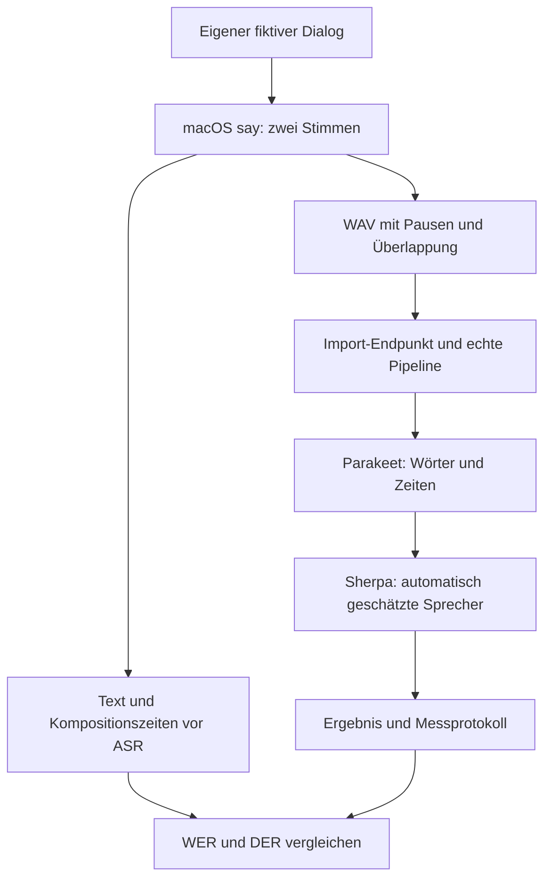
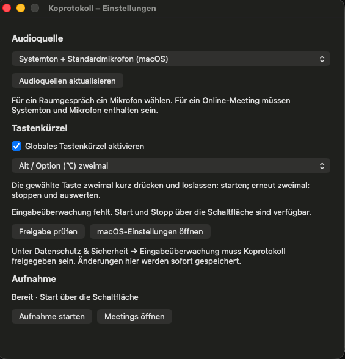
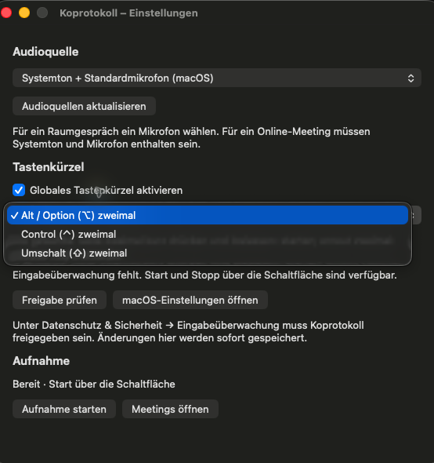
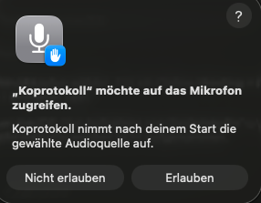
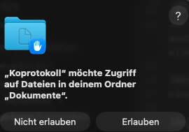
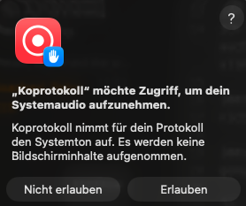
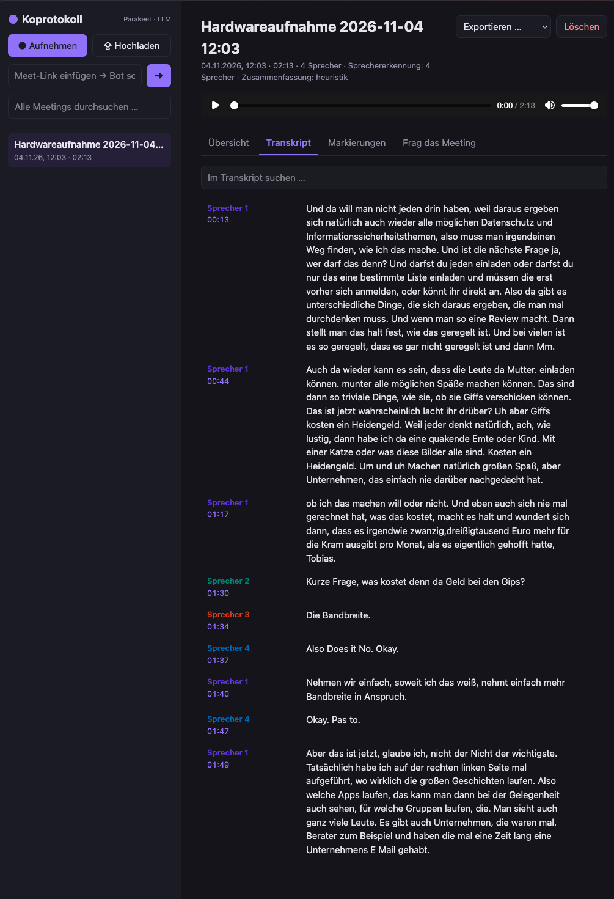
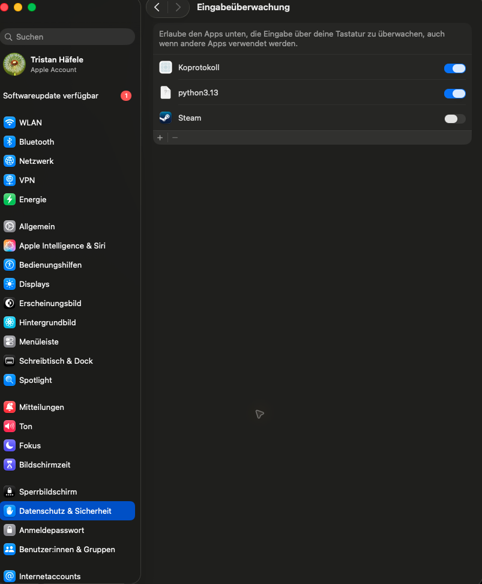

# Prüfprotokoll: lokale Hardwareaufnahme und Sprecherzuordnung (#31)

Dieses Protokoll beschreibt den reproduzierbaren Nachweis. Audioaufnahmen und
Referenzdateien bleiben außerhalb des Git-Verlaufs. Die Screenshotgalerie enthält
den vom Nutzer am 04.11.2026 ausdrücklich zur Aufnahme in den Repo-Nachweis
bereitgestellten Transkriptausschnitt. Die Übernahme bezieht sich auf dieses
Bild; weitere Gesprächsinhalte und Zugangsdaten werden nicht übernommen.

Die [Screenshots der Mac-App und der Freigaben](#screenshots-der-mac-app-und-der-freigaben)
zeigen die während der Erprobung sichtbaren Einstellungen und macOS-Dialoge.

## Aufbau

Der Test nutzt keinen Meeting-Bot, keine Browser-Audiofreigabe und keine
bestimmte Meeting-Anwendung. Die Koprotokoll-Oberfläche erfasst einen vom
Betriebssystem sichtbaren Hardware- oder Loopback-Eingang direkt. Beim Stopp
schließt sie die unveränderte WAV-Datei ab und startet erst dann die Pipeline.
Damit ist die zeitliche Trennung prüfbar: Zeitpunkt der WAV-Datei vor Import,
Pipeline-Logs und Meeting-Zeitstempel danach.

## Durchführung

1. Eine freigegebene Zwei-Sprecher-Testunterhaltung von 2–3 Minuten über einen
   vorhandenen Hardware- oder Loopback-Eingang aufzeichnen. Sie enthält
   Sprecherwechsel, kurze Einwürfe, Pausen und mindestens eine Überlappung.
2. Vor dem Import mit `ffprobe` Dauer, Samplerate, Kanäle, Pegel/Übersteuerung
   und beide Stimmen prüfen. Die Original-WAV unverändert aufbewahren.
3. Aus dem Originalton unabhängig eine Referenz mit Worttext, Sprecher und
   Zeitgrenzen erstellen. Sie darf nicht aus dem Modellresultat abgeleitet sein.
4. WAV zunächst ohne vorgegebene Sprecherzahl importieren, das API-Ergebnis
   sichern und mit `scripts/evaluate_audio_sample.py` messen. Eine zusätzliche
   Auswertung mit `num_speakers=2` getrennt als Vergleichslauf kennzeichnen.
5. Nach dem Modell-Download den gleichen Lauf mit gesperrtem externem Netzwerk
   wiederholen. Lokale Verbindungen zu `127.0.0.1` bleiben erlaubt. Die Sperre
   und jeden Verbindungsversuch protokollieren.
6. CPU getrennt messen: während der Aufnahme (nur `ffmpeg`) und während der
   Verarbeitung (Parakeet/Sherpa). Keine Nullbelastung behaupten.

Die auszufüllenden Werte sind: Commit-ID, Betriebssystem, Eingangstyp,
Audioformat, Dauer, angeforderte/erkannte Sprecherzahl, Modellstände, ASR- und
Diarisierungsdauer, WER, DER, CPU-Messung, Netzwerksperre und die Grenzen der
Überlappung. Eine kleine Prüfmatrix muss Firefox, Chromium, Safari, Desktop und
Mobil getrennt aufführen: Ohne praktischen Test bleibt eine Kombination offen.

## Gegenwärtiger Stand

Am 03.11.2026 wurde der Audioweg auf diesem Mac kurz mit der damals laufenden,
freigegebenen Unterhaltung erprobt. Die Originaldateien liegen ausschließlich
unter den ignorierten lokalen Testdaten und sind nicht Teil des Repositories.
Die Messungen belegen keinen vollständigen Mitschnitt:

- Ein direkter Hardwaremitschnitt dauerte 2,68 s bei 24 kHz und zwei Kanälen;
  der Spitzenpegel lag bei −57,8 dBFS, der RMS-Pegel bei −73,5 dBFS.
- Ein 3,14-s-Versuch über ScreenCaptureKit ergab sowohl für Systemton als auch
  Mikrofon −120 dBFS; es kam dort kein messbares Signal an.
- Ein weiterer gemischter Mitschnitt dauerte 1,14 s und erreichte −0,5 dBFS
  Spitzenpegel. Die zugehörige Mikrofonspur enthielt jedoch nur 0,10 s.

Diese kurzen Versuche enthalten keine geprüfte Referenz und erlauben keine
Aussage über Sprecherzahl, Vollständigkeit oder Transkriptionsqualität. Sie
zeigen, dass Pegel und Spurlänge vor dem Start der Pipeline geprüft werden
müssen. Koprotokoll verwirft die Systemtonaufnahme inzwischen, wenn sich die
Dauer der System- und Mikrofonspur um mehr als 0,5 s unterscheidet; der konkrete
1,14-s/0,10-s-Fehlversuch wird damit vor dem Anlegen eines Meetings gestoppt.
Ein verwendbarer Zwei-Sprecher-Durchlauf, Offline-Wiederholung, CPU-Werte,
Browser-/Mobilmatrix und Bildschirmaufnahme stehen aus. Es werden
keine privaten Gesprächsinhalte oder Audio-Dateien veröffentlicht.

## Fortsetzung nach der Issue-Aktualisierung vom 03.11.2026

Ausgangspunkt dieser Prüfung: `bb0fb50` auf
`agent/31-lokaler-audionachweis`, macOS 26.7.2 (25G332).
`python scripts/capture_audio.py --list` meldete BlackHole 2ch und DJI MIC MINI.
Firefox und OBS liefen als Prozesse; eine eigenständige alfaview-Anwendung
war in der Prozessliste nicht zu sehen. Daraus lässt sich weder die tatsächliche
Tonquelle noch ein funktionierender Aufnahmeweg ableiten. Es wurde kein neues
Gespräch aufgezeichnet.

`ffprobe` konnte die Dauer aller 17 vorhandenen lokalen WAV-Dateien lesen:
0,02 bis 3,141271 Sekunden. Keine erfüllt die geforderte Länge. Referenz,
Vollständigkeit beider Stimmen und Freigabe zur Veröffentlichung sind für diese
Dateien nicht nachgewiesen. Der vollständige Durchlauf bleibt offen.

Das bestehende Messwerkzeug hatte einen reproduzierbaren Fehler: Bei einer
Referenzstimme von Sekunde 0 bis 1 und einer Hypothese von 0 bis 2 meldete es
mit `collar=0` DER 0. Die zusätzliche Sekunde in der Referenzpause wurde
ausgelassen. Die Korrektur zählt sie als eine Sekunde Fehlalarm und liefert
DER 1. Die Tests verwenden ausschließlich künstliche Zeitsegmente und Texte;
sie sind kein Nachweis der Modellqualität. Bewertungsregeln und neue Felder
stehen zentral in der [Aufnahmeanleitung](../hardware-aufnahme.md#in-koprotokoll-importieren-und-prüfen).

Zusätzlich korrigiert: Referenzen als JSON-Liste verursachen keinen Absturz
mehr; geänderte Raster-/Toleranzparameter erscheinen korrekt im Bericht.
Fehlende Referenzzeit wird als nicht bestimmbar ausgewiesen, Überlappungen
werden gesondert bewertet und Fehlerzeitstellen sind auslesbar.

Die bisher ergänzte native ScreenCaptureKit-Integration überschreitet die
aktuelle Abgrenzung von #31 zu #17. Sie wurde in dieser Fortsetzung weder
erweitert noch als bestandener Nachweis gewertet; ihre Zuordnung ist vor
einem PR zu klären. Der vorhandene Hardwarepfad startet die Verarbeitung direkt
beim Stopp. Eine vorgelagerte Hörprüfung durch die Person ist damit weiterhin
nur über die separat gespeicherte Datei mit anschließendem Import möglich.

Offen bleiben der reale Zwei-Sprecher-Durchlauf, menschlich geprüfte Referenz,
Modell- und CPU-Messungen, nachgewiesene Netzwerksperre, Browser-/Gerätematrix,
freigegebenes öffentliches Sample und hörbare Bildschirmaufnahme. In dieser
Fortsetzung wurden keine Browser- oder Mobiltests ausgeführt und keine
Oberfläche geändert.

Prüfung der Korrektur gegenüber dem oben genannten Ausgangscommit:
`.venv/bin/pytest -q -ra` — **81 bestanden in 31,77 s**, keine übersprungenen
Tests. Davon prüfen 24 Tests das Messwerkzeug; der Ausgangsstand hatte insgesamt
61 bestandene Tests. `git diff --check` meldete keine Formatfehler.
Diese Ergebnisse gelten für die gemeinsam mit diesem Nachweis committete
Änderung, nicht für einen echten Modelllauf.

## Synthetisches Testgespräch auf Nutzerauftrag (03.11.2026)

Nachdem kein vollständiger Originalmitschnitt vorlag, wurde auf ausdrücklichen
Nutzerauftrag ein Testgespräch produziert. `scripts/generate_audio_sample.py`
enthält den fiktiven Dialog über ein Nachbarschaftsfest und erzeugt ihn lokal
mit den installierten macOS-Stimmen Anna und Eddy (Deutsch/Deutschland).
Keine Stimme wurde geklont, kein privates Gespräch verwendet und kein
externer Sprachdienst aufgerufen. Die Dateien liegen unter dem ignorierten
Ordner `data-livetest-31/synthetic-20261103/sample/`.

- Dauer der dekodierten WAV: **145,562833 s**, 48 kHz, Mono, PCM 16 Bit.
- Zwei getrennte Stimmspuren, 14 Sprechabschnitte, kurze Einwürfe und Pausen.
- Geplante Überlappung: **98,449771–99,749771 s** (1,3 s).
- Spitzenpegel des erzeugten Mixes: −1,41 dBFS; RMS: −21,22 dBFS;
  keine übersteuerten Samples. Der dekodierte Mix entspricht der Summe der
  Einzelspuren bis auf PCM-Quantisierung.
- SHA-256 des WAV-Originals:
  `1e586e8d195f2aa307b6c8cdae42d77c181a821fd9debb0d6fd306aa546f7339`.

`testgespraech.mp3` dient zum Anhören; die Pipeline erhält ausschließlich
`testgespraech.wav`. `referenz.json` und `dialog.txt` entstehen aus Text und
Kompositionszeiten **vor** der ASR-Auswertung. `herkunft.json` enthält Stimmen,
Parameter, Pegel und Hash. Die Rohclips und getrennten Stimmspuren bleiben
erhalten. Diese Kompositionsreferenz ist nicht menschlich hörgeprüft;
Abschnittsgrenzen enthalten innere Sprechpausen. WER/DER dagegen sind daher
technische Vergleichswerte dieses künstlichen Samples, kein Qualitätsnachweis
für reale Gespräche und kein Ersatz für die im Issue geforderte Hörreferenz.

### Reproduzieren

Voraussetzungen: macOS mit den genannten installierten Stimmen, `say`, ffmpeg,
die Entwicklungsumgebung und bereits vorbereitete Parakeet-/Silero-/Sherpa-Modelle
(siehe `scripts/download_models.py`). Neue Ausgabeordner verwenden; vorhandene
Ergebnisse werden nicht überschrieben.

```bash
python scripts/generate_audio_sample.py data-livetest-31/synthetisch
HF_HUB_OFFLINE=1 HF_HUB_DISABLE_TELEMETRY=1 python scripts/run_audio_sample.py \
  data-livetest-31/synthetisch/testgespraech.wav \
  data-livetest-31/lauf-lokal --models data/models
```

Der zweite Befehl verwendet den echten Upload-Endpunkt über FastAPI-TestClient
im selben Prozess und die echte Pipeline, ohne nachgebildete Modelle. Die
Sprecherzahl bleibt automatisch. Ein LLM ist ausgeschaltet; die Zusammenfassung
verwendet die lokale Heuristik. Das Skript sichert `ergebnis.json`,
`messung.json` und `pipeline.log`; der Originalhash wird vor und nach dem Lauf
verglichen. Die CPU-Werte beziehen sich auf den Python-Prozess, nicht auf die
gesamte Maschine oder ausgelagerte Apple-Dienste. Modellladezeit ist enthalten;
Gesamtzeit enthält auch Import, Export und Modellhashes.

Für die Wiederholung unter nachgewiesener macOS-Netzwerksperre:

```bash
sandbox-exec -p '(version 1)(allow default)(deny network*)(allow network-inbound (local ip "localhost:*"))(allow network-outbound (remote ip "localhost:*"))' \
  env HF_HUB_OFFLINE=1 HF_HUB_DISABLE_TELEMETRY=1 \
  python scripts/run_audio_sample.py \
  data-livetest-31/synthetisch/testgespraech.wav \
  data-livetest-31/lauf-gesperrt --models data/models --verify-network-block
python scripts/evaluate_audio_sample.py \
  data-livetest-31/synthetisch/referenz.json \
  data-livetest-31/lauf-gesperrt/ergebnis.json > data-livetest-31/vergleich.json
```

Die Sperrprüfung muss externe TCP-Verbindungen über IPv4 und IPv6 mit
`EPERM`/`EACCES` ablehnen und eine TCP-Verbindung über Loopback zulassen.
Timeouts oder fehlende Erreichbarkeit genügen nicht. Ein zunächst zu weit
gefasstes Profil mit `allow network* (local ip …)` ließ die externe Verbindung
zu und wurde durch diese Prüfung verworfen. Nur das oben gezeigte, nach Richtung
getrennte Profil bestand die Prüfung. Die Sperre gilt für den Testprozess und
seine Kinder, nicht für den ganzen Mac. Das Python-Audit protokolliert dessen
Socket-Versuche einschließlich der Sperrproben; es ist kein vollständiges
Netzwerklog nativer Bibliotheken.

Die Produktion und der Dateiimport prüfen keinen Mikrofon-/Systemtonweg.
Browser-/Mobilvergleich, Aufnahme-CPU, menschliche Hörprüfung und ein
Bildschirmvideo bleiben gesondert offen. Es wurde nichts öffentlich hochgeladen;
die Nutzungsbedingungen der verwendeten Systemstimmen wurden nicht für eine
öffentliche Weiterverteilung geprüft.

### Gemessener Lauf mit den echten Modellen

Getesteter Produktcode: `76eabdc429cc0d546f5112407c2a6184a471e98a` mit den
in dieser Fortsetzung ergänzten Produktions-/Prüfskripten. Keine Änderung an
ASR, Diarisierung oder Pipeline. Umgebung: macOS 26.7.2, Apple Silicon;
onnx-asr 0.12.0, onnxruntime 1.31.1, sherpa-onnx 2.0.1.
Parakeet TDT 0.6b v3, int8, Cache-Revision
`8f23f0c03c8761650bdb5b40aaf3e40d2c15f1ce`; Silero-Revision
`b3e3ee3cce4c11ceb63b1a0b229d916069c1ddf6`. Sherpa verwendet die vorhandene
pyannote-Segmentierung 3.0 und ERes2Net-Embeddings, Clustering-Schwelle 0,8.
Die lokalen JSON-Messdateien enthalten die Modellhashes, `modelle.json`
zusätzlich die Hashes der Parakeet-/Silero-Dateien. ONNX Runtime nutzte den
automatisch gewählten CoreML-Pfad mit nicht dort unterstützten Graphanteilen.

Der erste Importlauf (`run-local/`) endete mit `done` und explizit
`meta.diarization.status=completed`. Automatisch erkannte Sprecherzahl: **2**;
die Rohlabels 0 und 2 wurden für die Auswertung den Kompositionsstimmen A und B
zugeordnet. Transkription: **101,323 s**, Diarisierung: **83,638 s**;
Gesamtlauf: **185,637 s**. Prozess-CPU im Mittel: 109,97 % während der
Transkription, 87,09 % während der Diarisierung (100 % entspricht einem Kern).
Es lief kein Bildschirmrecorder für diesen Nachweis; andere bereits laufende
Programme wurden nicht beendet, daher ist dies kein isolierter Leistungsbenchmark.

Gegen die synthetische Kompositionsreferenz: **WER 9,94 %** (312 Referenzwörter,
1 Einfügung, 9 Löschungen, 21 Ersetzungen), **DER 1,3975 %** mit dem Standardraster
und der Standardtoleranz. Zahlen als Ziffern gegenüber ausgeschriebenen Wörtern
zählen bei dieser WER als Unterschiede. Beispiele im tatsächlichen Ergebnis:

- Bei **44,16–44,72 s** fehlt der Einwurf „Stimmt.“ im Transkript;
  die Diarisierung verwechselt die Stimme im verbleibenden Rasterabschnitt
  **44,4–44,5 s**.
- Bei **98,45–100,17 s** fehlt „Das Kabel habe ich schon!“ im Text. Der
  überlagerte Bereich samt Anschluss enthält stattdessen fehlerhafte Wörter,
  unter anderem „Don't feel it more deep box.“. Die getrennte DER für die
  Überlappung ist trotzdem 0: Sie prüft nur die aktiven Sprecher, nicht die
  Wörter. Nach Ausschluss der Grenztoleranz verbleiben hier lediglich 0,8 s
  beziehungsweise 1,6 Referenzsprechersekunden. Daraus folgt keine korrekte
  Transkription gleichzeitigen Sprechens.
- Der Abschiedsgruß bei **143,47–144,56 s** wird zu „This some stock.“.

Die Ergebnisse bleiben unverändert als `ergebnis.json`, `vergleich.json` und
lesbares `transkript.txt` erhalten; die fehlerhaften Stellen wurden nicht
nachträglich korrigiert.

### Abgeschlossene Offline-Wiederholung und Ablage

Der erste Offline-Lauf brach am 03.11.2026 wegen einer vollen internen Platte
mit `database or disk is full` ab. Dieser Fehlversuch bleibt in `run-offline/`
erhalten. Danach wurden ausschließlich die 55 neu erzeugten Testdateien nach
`/Volumes/blaue_platte/Koprotokoll-Nachweise/synthetic-20261103/` kopiert und
alle Datei-Prüfsummen verglichen. Erst nach identischer Prüfung wurde der
bisherige lokale Ordner durch einen Symlink auf diese Ablage ersetzt.
Die externe Platte muss deshalb für die lokalen Links angeschlossen sein.

Die Wiederholung in `run-offline-external/` war erfolgreich. Das WAV hatte
denselben oben angegebenen SHA-256. Beide externen TCP-Proben wurden mit
`errno=1` (`EPERM`) abgewiesen; die Loopback-Probe bestand. Das Python-Audit
enthält nur diese Proben, keine weiteren Socket-Versuche des Python-Codes.
Die Pipeline endete mit `done`, die Diarisierung mit `completed` und zwei
automatisch geschätzten Sprechern. Transkription: 36,306 s; Diarisierung:
64,611 s. Mittlere Prozess-CPU: 235,13 % beziehungsweise 99,38 % eines Kerns.
Aus den unterschiedlichen Laufzeiten folgt keine Leistungsverbesserung durch
die Netzwerksperre; Cache- und Systemzustand wurden nicht konstant gehalten.

Der erneute Vergleich mit der Kompositionsreferenz liefert WER 9,94 % und
DER 1,3975 %. Die Bewertung der Überlappung bleibt bei DER 0 mit den oben
erklärten Grenzen. `run-offline-external/transkript.txt` enthält den
unveränderten Text zum Nachlesen.

### Ablauf der ergänzten Prüfskripte

Der Ablauf folgt der [show-me-Originalanleitung](https://github.com/humanlayer/skills/blob/main/plugins/show-me/skills/show-me/SKILL.md).
Der Skill war lokal nicht installiert; dieses Mermaid-Diagramm verwendet den
in der Projektanleitung vorgesehenen Ausweichweg. Das Diagramm erklärt die
Dateien, die tatsächlichen Ergebnisse stehen in den Messdateien.



Qualitätsprüfung nach den [anti-slop-Originalquellen](https://github.com/miqdadbadjuber/anti-slop):
Textprüfung bestanden, da die Messwerte aus den gespeicherten Ergebnissen
stammen und die Referenz als synthetisch und nicht menschlich geprüft benannt
ist. Kommentarprüfung bestanden: Der Testkommentar beschreibt den fachlichen
Zweck der Überlappung statt die einzelnen Rechenschritte. UI-, Layout- und
Interaktionsprüfungen sind hier nicht anwendbar; die Oberfläche wurde in
dieser Fortsetzung nicht verändert. Die Regeln wurden an ihrer Quelle gelesen,
es wurde keine zweite Regeldatei oder Plugin-Konfiguration angelegt.

Abschlussprüfung am 04.11.2026: `.venv/bin/pytest -q -ra` meldete
**86 bestanden in 34,87 s**, keine übersprungenen Tests. Die fünf neuen
Prüffälle sichern Überlappung ohne Clipping, Erhalt vorhandener Originale
und das Zurückweisen unzureichender Offline-Belege ab. `git diff --check`
meldete keine Formatfehler.

## Privater Realtest mit einer vom Nutzer benannten MOV-Datei (04.11.2026)

Die Datei enthält eine AAC-Stereo-Tonspur mit 48 kHz und einer Containerdauer
von 19.735,102 s, also rund 5 Stunden 29 Minuten. Die vollständige Audiospur
wurde ohne Neukodierung als M4A gesichert. Für den ersten Test wurden
ausschließlich die ersten **180 Sekunden (00:00 bis 03:00)** als PCM-WAV
extrahiert. Die ganze Aufnahme wurde nicht transkribiert. Original, Tonspur,
Ausschnitt und Ergebnisse bleiben lokal außerhalb des Git-Verlaufs; es liegt
keine Freigabe zur Veröffentlichung dieser Gesprächsinhalte vor.

Der dekodierte Ausschnitt hat 48 kHz, zwei Kanäle und 180,000 s Länge.
RMS pro Kanal: −35,61 dBFS; Spitzenpegel: −12,80 dBFS; keine Samples erreichen
Vollaussteuerung. Die Kanäle sind nahezu identisch (Korrelation 0,99999985).
Die Stereo-Datei enthält damit keine praktisch getrennten Sprecherkanäle;
Koprotokoll wertet wie üblich den Mono-Mix aus. Diese Pegelprüfung beweist
weder die Verständlichkeit noch die Vollständigkeit aller Stimmen.

Der erste Modelllauf wurde durch eine Sitzungsunterbrechung beendet und bleibt
als unvollständiger Versuch erhalten. Die Wiederholung verwendet dieselbe
WAV-Datei und dieselbe praktisch geprüfte externe Netzwerksperre wie oben.
Quellpfad, Original- und Ausschnittshashes sowie Spurdaten stehen nur in der
lokalen Datei `herkunft.json` im Realtest-Ordner auf der blauen Platte.

Beim Wiederverwenden des Prüfskripts fiel dessen fester Titel
„Synthetischer Zwei-Stimmen-Test“ auf. Das Skript verwendet jetzt den Dateistamm,
damit reale Aufnahmen diesen irreführenden Titel nicht erhalten. Ein Test mit
echtem Upload-/Pipelineweg und nachgebildeten Modellen prüft Titel,
abgeschlossene Diarisierung und den unveränderten Originalhash.

Die Prüfung der Änderung mit `.venv/bin/pytest -q -ra` bestand am 04.11.2026
mit **87 Tests in 84,21 s**, keine übersprungenen Tests. Die Tests liefen
teilweise parallel zur Modellverarbeitung; deren Laufzeiten sind deshalb
kein isolierter Leistungsbenchmark. `git diff --check` meldete keine Fehler.

### Ergebnis des privaten Realtests

Getesteter Code: `1e1af11` mit dem zuvor beschriebenen WAV-Ausschnitt.
Die Wiederholung endete mit `status=done` und
`meta.diarization.status=completed`: **eine automatisch geschätzte
Sprechergruppe**, 12 Rohabschnitte der Diarisierung, sieben Textabschnitte
mit insgesamt 484 durch Leerzeichen getrennten Wörtern. Die erste Textzeit
liegt bei 0,11 s, die letzte bei 180,00 s. Das Transkript reicht damit zeitlich
bis zum Ausschnittsende; seine inhaltliche Vollständigkeit ist nicht geprüft.
Die Sprechererkennung wurde ausgeführt und lieferte keinen Fehler-Rückfall.

Dieses Ergebnis bestätigt keine Mehrsprechertrennung. Der Nutzer beschreibt
verschiedene Personen in der gesamten Aufnahme; ob sie bereits in diesen
ersten drei Minuten sprechen, wurde nicht unabhängig am Originalton geprüft.
Die Zahl der realen Personen darf daher nicht aus der einen Modellgruppe
abgeleitet werden. Ohne menschliche Wort-/Sprecherreferenz werden für diesen
Realtest keine WER-/DER-Werte angegeben.

Die Netzwerkprüfung wies externe IPv4- und IPv6-Verbindungen mit `EPERM` ab;
Loopback blieb erreichbar. Der Ausschnittshash stimmt mit dem Pipeline-Eingang
überein. Hash und Änderungszeit des MOV-Originals wurden nach dem Lauf erneut
verglichen und sind unverändert.

Gemessene Laufzeiten: Transkription 301,333 s, Diarisierung 1.034,316 s,
Gesamtlauf 1.338,424 s. Die Prozess-Stichprobe zeigte aktive ONNX-Inferenz.
Eine Systemmessung während des Laufs zeigte 0 % CPU-Leerlauf, 127 laufbereite
Prozesse und eine Last über 300; der Testprozess hatte normale Priorität.
Andere Anwendungen wurden nicht beendet oder umkonfiguriert. Diese Messung
belegt hohe konkurrierende Last, nicht deren genauen Anteil an der Laufzeit.

Im lokalen Realtest-Ordner liegen die vollständige extrahierte Tonspur,
der dreiminütige WAV-/MP3-Ausschnitt und im Unterordner
`run-000000-000300-wiederholung/` das unveränderte `ergebnis.json`,
`transkript.txt`, `pruefbericht.json`, `pruefbericht.md`, `messung.json`
und `pipeline.log`. Es werden keine Gesprächsinhalte ins Repository übernommen.

Die erneute Abschlussprüfung vor dem Dokumentationscommit meldete
`.venv/bin/pytest -q -ra`: **87 bestanden in 177,90 s**, keine übersprungenen
Tests. Der Produktcode blieb seit `1e1af11` unverändert.

### Selbständig gefundene Mehrsprecher-Fundstelle (04.11.2026)

Der Nutzer kannte keine Zeitmarke mit Sprecherwechsel. Deshalb wurden kurze
Proben über die Aufnahme verteilt ausgewählt. Mehrere spätere Proben bestanden
vollständig aus Nullsamples. Eine anschließende Aktivitätsprüfung der gesamten
extrahierten Audiospur mit `ffmpeg silencedetect=noise=-60dB:d=3` ergab
27 nicht als Stille klassifizierte Bereiche mit zusammen rund 1.510,83 s.
Diese Bereiche können Pausen und Geräusche enthalten; sie sind keine
nachgewiesenen Sprachsegmente.

Innerhalb vorhandener Tonbereiche wurden je zwei benachbarte achtsekündige
Hälften mit dem bereits vorhandenen ERes2Net-Modell verglichen. Die
Kosinusabstände dienten ausschließlich zur Rangfolge von Suchkandidaten.
Es wurde weder eine neue Qualitätsschwelle eingeführt noch die Sprecherzahl
aus dem Abstand abgeleitet. Embeddingvektoren wurden nicht gespeichert;
Suchwerte und kurze Proben bleiben im privaten Realtest-Ordner.

Eine Auffälligkeit um 00:58:30 führte zum natürlichen Ausschnitt
**00:58:10 bis 00:59:10**. Er wurde als 16-kHz-Mono-WAV extrahiert und mit
dem unveränderten `SherpaDiarizer` geprüft: automatisch geschätzte
**zwei Sprechergruppen**, ohne vorgegebene Zahl, Clustering-Schwelle weiterhin
0,8. Die Prüfung dauerte 194,378 s bei 36,902 s Prozess-CPU. Diese Werte
entstanden erneut unter hoher Systemlast und sind kein Leistungsbenchmark.

Anschließend wurden dieselbe Datei mit `ParakeetTranscriber` transkribiert und
die echten, bereits berechneten Sprecherzeiten durch `build_utterances`
zugeordnet. Das ist eine Funktionsprüfung mit den echten Modellfunktionen,
kein weiterer API-/Browserdurchlauf. Ergebnis: 155 Wörter, sieben
Textabschnitte mit S1 und S2; letzte Wortzeit 59,838 s im 60-s-Ausschnitt.
Parakeet benötigte 142,683 s. Die Dateiprüfsumme wurde vor der Zusammenführung
mit derjenigen der Sprecherprüfung verglichen.

Der erste zugeordnete Wechsel zu S2 liegt in der Originalaufnahme bei
**00:58:18,150**. Weitere Wechsel liegen bei 00:58:32,820, 00:58:34,820
und 00:58:40,470. Das Modell liefert auch zeitweise überlappende Rohabschnitte.
Diese Grenzen und Gruppen wurden nicht unabhängig von einem Menschen
bestätigt; es werden keine Personen namentlich identifiziert und keine
WER-/DER-Werte behauptet.

Die privaten Dateien liegen unter
`stimmensuche/kandidat-005810-005910/` innerhalb des Realtest-Ordners:
`audio.wav`, `audio.mp3`, `sprecherzeiten.json`, `ergebnis.json` und
`transkript.txt`. Das Transkript verwendet Zeitmarken der Originalaufnahme.
MOV-Tonspur und extrahierte M4A beginnen laut `ffprobe` beide bei 0,000 s.
Alle Modellaufrufe erfolgten mit gesperrtem externem Netzwerk; es wurden
keine neuen Pakete oder Modelle installiert und keine Produkteinstellungen
verändert.

Die letzten zwölf Sekunden wurden separat mit demselben Parakeet-Modell
transkribiert. Letzte Wortzeit (59,838 s) und letzte 21 normalisierte Wörter
stimmen mit dem Rohtranskript überein. Diese Endkonsistenzprüfung ersetzt
keine menschliche Referenz. Die Ergebnisse liegen zusätzlich als
`endpruefung.json`, `fundstelle.json` und `fundstelle.md` bei den privaten
Dateien; Gesprächsinhalte bleiben außerhalb von Git.

Abschlussprüfung dieser Fortsetzung: `.venv/bin/pytest -q -ra` meldete
**87 bestanden in 138,79 s**, keine übersprungenen Tests.
`git diff --check` meldete keine Formatfehler; der Produktcode wurde nicht
geändert.

## Mac-Menüleiste und Alt-Doppeltipp (04.11.2026)

Bedienweg für den anschließenden Nutzertest ergänzt:
[`Koprotokoll.command`](../../Koprotokoll.command) baut und öffnet eine lokale
Menüleisten-App; Ablauf und Voraussetzungen stehen in der
[Aufnahmeanleitung](../hardware-aufnahme.md#mac-per-alt-doppeltipp-aufnehmen).
Die vorhandenen Aufnahme-Endpunkte übernehmen Start und Stopp. Es werden keine
neuen Audio- oder Transkriptionswege eingeführt.

Prüfungen unter macOS auf Apple Silicon:

- `.venv/bin/pytest -q -ra`: abschließend **90 bestanden in 109,85 s**, keine übersprungenen Tests.
  Der neue native Detektortest umfasst neun Fälle einschließlich Alt-Kombination,
  langem Halten, Zeitüberschreitung und wiederholtem Umschalten.
- Swift-App tatsächlich gebaut; `codesign --verify --deep --strict` und
  `zsh -n Koprotokoll.command` erfolgreich.
- App lokal gestartet, Serverstart und wiederholte Statusabfragen mit HTTP 200
  beobachtet. Geräteabfrage nach einem anfänglichen Timeout mit längerer
  Wartezeit wiederholt; die gespeicherte Quelle ist verfügbar.
- `GET /api/capture` bestätigte den Ruhezustand. Es wurde keine neue echte
  Aufnahme zur Prüfung dieser Steuerung ausgelöst.

Der globale physische Doppeltipp, macOS-Eingabeüberwachung und der vollständige
Start-/Stopp-Ablauf über die native App sind noch nicht bestätigt. Der
UI-Zugriff konnte die erste Fehlermeldung lesen, erreichte danach die reine
Menüleiste nicht (`noWindowsAvailable` bzw. `timeoutReached`). Die vorhandenen
Grenzen beim echten Systemton bleiben bestehen. Dies schließt #31 nicht ab.

### Einstellungen direkt in der Mac-App (04.11.2026)

Auf Nutzerwunsch hat dieselbe native App jetzt ein dauerhaftes
Einstellungsfenster: Audioquelle, Tastenkürzel ein/aus, Doppeltipp auf Alt,
Control oder Umschalt, Status der Eingabeüberwachung, Prüfung/Anforderung der
Freigabe und Einstieg in die macOS-Einstellungen. Start/Stopp und der Zugang
zu den Meetings sind ebenfalls im Fenster erreichbar. Das Fenster öffnet sich
beim App-Start und beim erneuten Öffnen; das Ko-Menü enthält „Einstellungen …“.
Ein Finder-Einstieg verweist auf das erzeugte App-Paket, ohne eine vorhandene
andere Installation zu überschreiben.

Die vorhandene Audioquellen-Auswahl bleibt erhalten. Alle Einstellungen liegen
an derselben Stelle in den App-Präferenzen, statt als zusätzliche Server- oder
Browserkonfiguration. Ändern oder Abschalten des Kürzels verwirft einen
begonnenen Doppeltipp. Während einer Aufnahme sind die Einstellungen gesperrt.

Prüfung: `.venv/bin/pytest -q -ra` meldete **92 bestanden in 104,58 s**, keine
übersprungenen Tests. Der native Test umfasst nun 14 Fälle einschließlich
Präferenz-Persistenz, Übernahme der vorhandenen Audioquelle, ungültigem
Tastennamen, Tastenwechsel und Abschalten zwischen zwei Tipps. Zwei zusätzliche
Python-Tests prüfen den Finder-Einstieg und den Erhalt einer vorhandenen App.
Swift-Build und Codesign-Prüfung bestanden.

Das neue Fenster wurde tatsächlich mit dem nativen UI-Werkzeug gelesen und
visuell geprüft: alle Bereiche und Schaltflächen sichtbar, gespeicherte
Audioquelle ausgewählt, Alt als Standard, Eingabeüberwachung als fehlend
gekennzeichnet. Ausschalten des Kürzels deaktivierte die Tastenwahl sichtbar;
anschließend wurde der eingeschaltete Alt-Standard wiederhergestellt. Die
Auswahlliste enthielt die drei vorgesehenen Tasten. Die Umschaltung auf Control
wurde durch eine Zustandsänderung während der UI-Automation nicht bestätigt;
der native Präferenztest deckt diese Speicherung separat ab.

Keine macOS-Freigabe wurde automatisch erteilt und keine echte Aufnahme gestartet.
Der vollständige Aufnahme-/Hotkey-Nachweis und die übrigen Grenzen oben bleiben offen.

### Reiner Systemaudio-Zugriff auf Nutzerwunsch (04.11.2026)

Tristan zeigte die macOS-Einstellungen mit ausgeschaltetem Koprotokoll-Eintrag
bei Bildschirmaufnahme und leerer Liste unter „Nur Aufnahme von Systemaudio“.
Sein Auftrag: ausschließlich Audiozugriff. Der bisherige ScreenCaptureKit-Weg
wurde durch einen privaten Core-Audio-Tap für Systemton und AVAudioEngine für
das Standardmikrofon ersetzt. Es gibt keine Bildschirm-/Fensterabfrage und
keinen Videoausgang. Der Tap bleibt ungemutet; Standardgeräte werden nicht
umgestellt. Das private Audiogerät wird beim Stoppen wieder entfernt.

Der Audio-Unterprozess verwendet denselben signierten App-Bundle wie das
Einstellungsfenster. Dessen Info.plist enthält nun sowohl
`NSAudioCaptureUsageDescription` als auch den Mikrofon-Zwecktext. Ein Start
des Audiowegs überschreibt keine vorhandene Server-/Portkonfiguration.
Freigabefehler werden aus dem Helfer an die Aufnahme-API gemeldet; ein vorzeitig
beendeter Helfer wartet nicht die gesamte Startfrist ab. Die verlängerte
Startfrist lässt Zeit für die erstmaligen macOS-Dialoge.

Native Prüfung ohne Zugriff auf reale Audioquellen: vorbereitete Float-Puffer
für Stereo-Systemton und zeitversetztes Mono-Mikrofon mit anderer Samplerate
werden über denselben Writer in ausgerichtete PCM-WAV-Spuren umgewandelt.
Format, Länge, nichtleere Samples, anfängliche Mikrofonpause und Schutz einer
vorhandenen Datei werden geprüft. Eine weitere Probe prüft, dass die Zeitachse
erst mit dem ersten Sample beginnt; die Freigabewartezeit wird nicht als Stille
vorangestellt. Die Linkerprüfung des Testprogramms und des tatsächlich gebauten
App-Binaries enthält Core Audio, aber kein ScreenCaptureKit.

Fokussierter Lauf: 23 Tests bestanden in 17,47 s. App und eigener Server wurden
nach Prüfung auf laufende Aufnahme/Auswertung im Ruhezustand neu gestartet.
`GET /api/capture` bestätigte anschließend `active:false`. Das echte App-Fenster
zeigt den neuen Hinweis auf Systemaudio- und Mikrofonfreigabe; die separate
Eingabeüberwachung für den globalen Hotkey war weiterhin nicht erteilt.

Abschließende Suite: **96 bestanden in 62,35 s**, keine übersprungenen Tests.

Während der Fortsetzung wurde über die Oberfläche eine Aufnahme gestartet
(`POST /api/capture/start`: HTTP 200), gestoppt (HTTP 201) und als Meeting mit
Quelle Hardware und Systemaudio-Gerätekennung gespeichert. Beide getrennten
Spuren: 132,998 s, 48 kHz, zwei Kanäle. Systemton Peak 0,912628 / RMS 0,078603,
Mikrofon Peak 0,119110 / RMS 0,001363 (lineare PCM-Amplituden, keine Lautheitsmessung).
Beide enthalten Samples ungleich null; damit sind Tonspuren und Signal belegt,
noch keine vollständige inhaltliche oder menschliche Sprecherprüfung.
Diese Aufnahme begann vor dem letzten App-Neubau. Die abschließende Korrektur
„Zeitachse ab erstem Sample“ wurde danach im nativen Writer-Test geprüft und
ist nicht durch diesen bereits laufenden Hardware-Mitschnitt belegt.

Die macOS-Seite wurde anschließend mit dem nativen UI-Werkzeug gelesen:
**Koprotokoll aus** bei „Aufnahme von Bildschirm & Systemaudio“,
**Koprotokoll an** unter „Nur Aufnahme von Systemaudio“. Es wurden durch den
Agenten keine Berechtigungsschalter geändert. Ein weiterer Serverneustart wurde
abgebrochen, weil bereits die Transkription der Aufnahme lief; sie wurde nicht
unterbrochen. Aufnahme und Inhalte bleiben außerhalb von Git.

Der echte Systemaudio-Aufnahmeweg und der passende macOS-Eintrag sind damit
belegt. Der globale Alt-Doppeltipp, eine unabhängig geprüfte Wort-/Sprecherreferenz
und die übrigen #31-Anforderungen bleiben offen. Der alte, ausgeschaltete
Bildschirmaufnahme-Eintrag bleibt in den Systemeinstellungen sichtbar.

API-Grundlage: [Apples Core-Audio-Tap-Beispiel](https://developer.apple.com/documentation/coreaudio/capturing-system-audio-with-core-audio-taps)
und [Audio-Zwecktext](https://developer.apple.com/documentation/bundleresources/information-property-list/nsaudiocaptureusagedescription).

## Screenshots der Mac-App und der Freigaben

Auf Nutzerwunsch am 04.11.2026 aus den bereitgestellten Bildern und dem lokalen
Screenshot-Ordner ergänzt. Die Bilder zeigen historische Zwischenstände.
Codebezug: `d795e04ed1cc89733c7ecb8655a82d687b60ba2a` für das Einstellungsfenster,
`75b291c329f3ed9c069b0cc1c6029c4ff69a0bb1` für den späteren reinen Audioweg.
Eine Build-ID direkt zum jeweiligen Aufnahmezeitpunkt wurde nicht protokolliert;
die Bilder werden deshalb nicht als Screenshots exakt dieser Commits ausgegeben.

Der show-me-Skill steht in dieser Sitzung nicht zur Verfügung. Die beschrifteten Abbildungen
verwenden die in den [Nachweisregeln](README.md#änderungen-mit-show-me-erklären)
vorgesehene Alternative. Der Ablauf ist: Audioquelle und Kürzel in der App
wählen, nötige macOS-Freigaben bestätigen, Aufnahme starten und stoppen.
Die Auswertung beginnt anschließend. Die zugehörigen ausgeführten Prüfungen
und deren Grenzen stehen in den Abschnitten oben.

### Einstellungen der Mac-App



**11:10:00 Uhr laut Originaldateiname.** Sichtbar sind Audioquelle,
Tastenkürzel-Einstellungen, Freigabehinweis sowie Start- und Meeting-Schaltfläche.
Die App ist bereit, nimmt aber nicht auf. Das Bild zeigt ausdrücklich noch
fehlende Eingabeüberwachung und belegt keinen funktionierenden globalen Hotkey.
Der Hinweis auf die reine Audiofreigabe wurde erst später ergänzt.

### Auswahl der Doppeltipp-Taste



**Vom Nutzer bereitgestellter Screenshot.** Die Liste bietet Alt/Option,
Control und Umschalt an; ausgewählt ist Alt. Sichtbar ist die Auswahlmöglichkeit,
kein ausgelöster Doppeltipp und keine laufende Aufnahme. Ein genauer
Aufnahmezeitpunkt ist für diesen Anhang nicht belegt.

### Mikrofonzugriff



**12:01:03 Uhr laut Originaldateiname.** macOS zeigt Koprotokolls
Mikrofon-Zwecktext. Das Bild dokumentiert die Anfrage vor der Entscheidung;
es zeigt weder die erteilte Freigabe noch die spätere Audioaufzeichnung.
Systemaudio und Eingabeüberwachung haben eigene Freigaben.

### Dateizugriff beim Start aus dem Entwicklungsprojekt



**11:49:19 Uhr laut Originaldateiname.** Dieser Entwicklungsstand liegt im
Ordner Dokumente und startet dort den lokalen Server. Das Bild zeigt die
zusätzliche Dateizugriffsabfrage dieser Installation. Es ist kein Nachweis
einer Mikrofon-, Systemaudio- oder Bildschirmfreigabe.

### Separate Systemaudio-Abfrage



**Weiterer Nutzeranhang vom 04.11.2026.** Der Dialog fragt ausdrücklich nach
Systemaudio. Der Zwecktext erklärt, dass Koprotokoll Systemton für das Protokoll
aufnimmt und keine Bildschirminhalte erfasst. Sichtbar ist die Anfrage vor der
Entscheidung. Den später eingeschalteten Audioeintrag dokumentiert die oben
beschriebene Prüfung der Systemeinstellungen.

### Fertige Auswertung der Hardwareaufnahme



**Vom Nutzer zur Aufnahme in den Repo-Nachweis bereitgestellt.** Das Bild zeigt
die 133-Sekunden-Aufnahme, den Audioplayer und das Rohtranskript mit Zeitmarken
und vier Sprecherlabels. Die Zusammenfassung verwendet die Heuristik.
Die lokale API bestätigte bei dieser Ergänzung `status: done`, Fortschritt 1,0
und vier Sprechergruppen. Die Aufnahme wurde inzwischen vollständig verarbeitet.

Der Nutzer bestätigte anschließend ausdrücklich, dass der sichtbare Inhalt
unsensibel ist und dieses Bild auch in die README aufgenommen werden soll.
Die README verweist auf dieselbe Bilddatei wie dieser Nachweis.

Der sichtbare Wortlaut ist ein Modellergebnis und enthält erkennbare Fehler.
Vier Labels belegen vier Modellgruppen, keine unabhängig bestätigte Zahl realer
Personen. Das Bild dient als Nachweis des sichtbaren Ergebnisses; eine menschlich
geprüfte Wort-/Sprecherreferenz und Qualitätsmessung werden daraus nicht abgeleitet.
Die Originalaufnahme bleibt außerhalb des Git-Verlaufs.

Der gleichzeitig bereitgestellte Zertifikatsdialog stammt laut Nutzer aus einer
anderen Anwendung. Er wird deshalb nicht als Koprotokoll-Befund übernommen;
an Zertifikatsprüfung oder Vertrauenseinstellungen wurde nichts geändert.

Prüfung dieser Ergänzung: sechs Bildverweise und PNG-Daten erfolgreich geprüft,
Text-/EXIF-Metadaten entfernt, Originale unverändert. `.venv/bin/pytest -q -ra`:
**96 bestanden in 62,08 s**, keine übersprungenen Tests.

### Herkunft und Bereinigung

Bildpixel, Abmessungen und Farbprofile wurden unverändert übernommen. Entfernt
wurden ausschließlich PNG-Text-/EXIF-Metadaten. Alle bild- und farbrelevanten
PNG-Blöcke wurden vor und nach der Übernahme byteweise verglichen; die Originale
blieben unverändert. Die ursprünglichen vier Ansichten wurden auf sichtbare private Inhalte
geprüft. Doppelte Bilder und eine Ansicht mit einem fremden Fenster am Rand
wurden nicht übernommen. Die beiden ergänzten Nutzeranhänge zeigen den
Systemaudio-Dialog und den ausdrücklich zur Übernahme beauftragten
Transkriptausschnitt. Audiodateien und Zugangsdaten sind nicht enthalten.

Prüfung der Ergänzung: vier relative Bildverweise und die internen Zielabschnitte
vorhanden, PNG-Prüfsummen und dekodierbare Bilddaten geprüft, keine Text-/EXIF-Blöcke.
`.venv/bin/pytest -q -ra`: **96 bestanden in 87,59 s**, keine übersprungenen Tests.
`git diff --check` meldete keine Formatfehler.

| Eingebundene Datei | Originalquelle |
| --- | --- |
| `app-einstellungen.png` | Screenshot-Ordner: `Bildschirmfoto 2026-11-04 um 11.10.00.png` |
| `app-tastenauswahl.png` | Nutzeranhang `image.png` mit geöffneter Doppeltipp-Auswahl |
| `mikrofon-freigabe.png` | Screenshot-Ordner: `Bildschirmfoto 2026-11-04 um 12.01.03.png` |
| `dokumente-freigabe.png` | Screenshot-Ordner: `Bildschirmfoto 2026-11-04 um 11.49.19.png` |
| `systemaudio-freigabe.png` | Weiterer Nutzeranhang `image.png` mit Systemaudio-Abfrage |
| `transkript-realaufnahme.png` | Weiterer Nutzeranhang `image.png` mit Ergebnis der 133-Sekunden-Aufnahme |
| `eingabeueberwachung-freigegeben.png` | Weiterer Nutzeranhang `image.png` mit eingeschalteter Eingabeüberwachung |

<details>
<summary>SHA-256 der unveränderten Originaldateien</summary>

```text
f282e1a8527afb1ba98ef3fbaccb773bc52fdde7895cac5652ddd5e5989d0213  app-einstellungen.png (Original)
ed92c079c110a96b3acd8799941c5e5a5e1d99c674249be1bea7e6963b5c2fd8  app-tastenauswahl.png (Original)
1630214a6021bea78c1ece3676c45adf170e655018900f8269f1f330d59e0312  mikrofon-freigabe.png (Original)
fd5741a1192b4fee9d9aa36f8f28c8780a599b1c66eb1f37cf0fd6486ed72395  dokumente-freigabe.png (Original)
b2e61c63c923a5faf90e12e20a482b3c1f568f5fd7001a7eaa18e7cb78db801b  systemaudio-freigabe.png (Original)
cc753866444a0d3eca8267fe7f9744df4b73ea8e7b63194a14456f21baf10772  transkript-realaufnahme.png (Original)
d58e67d8ae1cc1ee60d9139fac1e869e51a7b8b0cb2cc13f32ecfe0d0576000e  eingabeueberwachung-freigegeben.png (Original)
```

</details>

Die später bestätigte reine Systemaudio-Freigabe und die 133-Sekunden-Aufnahme
sind [im Audioweg-Abschnitt](#reiner-systemaudio-zugriff-auf-nutzerwunsch-04112026)
dokumentiert. Die hier eingebundenen Dialogbilder ersetzen diesen gesonderten
Nachweis nicht. Der globale Hotkey und die menschliche Wort-/Sprecherreferenz
bleiben offen.

## Nachprüfung des weiterhin ausgefallenen Tastenkürzels

Nutzerbefund nach der Aufnahme: Der Alt-Doppeltipp funktioniert weiterhin
nicht. Am 04.11.2026 zeigte die native macOS-Eingabeüberwachung Koprotokoll
eingeschaltet, während die App weiterhin „Eingabeüberwachung fehlt“ meldete.
Damit wird die Abtastung durch die vorhandene Freigabeprüfung nicht gestartet;
die reinen Detektortests können diesen macOS-Zustand nicht abdecken.

Der laufende Prozess stammte von 11:59:21 Uhr, das App-Binary war zuletzt um
12:02:19 Uhr gebaut worden. Seine Ad-hoc-Signatur bindet die Identität an den
Codehash. Als erste Prüfung wurde ausschließlich die Menüleisten-App aus dem
unveränderten Bundle neu gestartet; der Server blieb bestehen, keine Aufnahme
lief. Danach meldete auch der neue Prozess noch fehlende Eingabeüberwachung.
Ein einfacher Neustart hat den Fehler damit nicht behoben.

Die Hypothese einer veralteten, zum aktuellen Build nicht wirksamen Freigabe
wird durch erneutes Anwenden des vorhandenen Koprotokoll-Eintrags geprüft.
macOS verlangte dafür eine Authentifizierung im Systemdialog. Zum Zeitpunkt
dieser Dokumentation war diese Bestätigung noch ausstehend. Der Agent hat
keine Zugangsdaten eingegeben und keine Berechtigungsprüfung umgangen.
Die tatsächliche Hotkey-Reparatur und ein Start-/Stopp-Test per Doppeltipp
sind bis zu dieser Bestätigung nicht nachgewiesen.


### Erneut angewendete Eingabefreigabe nach Mac-Neustart

Am 04.11.2026 wurde auf Nutzerwunsch nach dem Mac-Neustart die bestehende
Eingabefreigabe erneut angewendet. Nach der Bestätigung im macOS-Systemdialog
wurde der vorhandene Koprotokoll-Schalter eingeschaltet und **Beenden & erneut
öffnen** gewählt. Der neue App-Prozess meldete weiterhin fehlende Freigabe.

Danach wurde ausschließlich der bestehende Koprotokoll-Eintrag aus der
Eingabeüberwachung entfernt und dasselbe aktuelle App-Bundle aus
`data/desktop/Koprotokoll.app` erneut hinzugefügt. Nach **Beenden & erneut
öffnen** zeigte die App um 13:03 Uhr: **„Eingabeüberwachung freigegeben.
Tastenkürzel aktiv.“** Der Systemschalter war eingeschaltet, die Aufnahme stand
auf **„Bereit · Alt / Option (⌥) zweimal“**. Das Bundle wurde dabei weder neu
gebaut noch neu signiert. Andere App-Freigaben wurden nicht verändert.

Damit ist die Freigabeprüfung für diesen laufenden Build erfolgreich. Ein
physischer Alt-Doppeltipp mit bestätigtem Aufnahme-Start und -Stopp ist noch
nicht nachgewiesen. Der Nutzer wurde um diesen kurzen Funktionstest gebeten.
Die Anleitung beschreibt den gezielten Austausch eines veralteten Eintrags.
Vor dieser reinen Dokumentationsänderung bestanden am unveränderten Code von
`0819fcf` **96 Tests in 37,50 s**, am Basisstand `c71326c` **87 Tests in 33,78 s**;
beide Läufe mit `pytest -q -ra`, ohne übersprungene Tests.


### Nutzer bestätigt den Alt-Doppeltipp

Am 04.11.2026 meldete der Nutzer nach der erneuerten Eingabefreigabe:
**„alt doppelklick funktioniert jez“**. Damit ist die Funktion des physischen
Doppeltipps durch eine Nutzerrückmeldung bestätigt. Die vorangegangene Bitte,
einen Passwortdialog zu bestätigen, war zu diesem Zeitpunkt überholt.

Anschließend beantwortete der Nutzer die ausdrückliche Frage nach sichtbarem
Aufnahmestart und erneutem Alt-Doppeltipp zum Stoppen mit:
**„Start und Stopp funktionieren“**. Damit sind beide Aktionen durch den
physischen Nutzertest bestätigt. Eine neue inhaltliche Prüfung der resultierenden
Aufnahme wird daraus nicht abgeleitet. Das App-Bundle wurde für diese Prüfung
nicht verändert, gebaut oder neu signiert.

Prüfung dieser Dokumentation: `pytest -q -ra` → **96 bestanden in 36,87 s**,
keine übersprungenen Tests; `git diff --check` ohne Befund.


### Screenshot der eingeschalteten Eingabeüberwachung



**Weiterer Nutzeranhang vom 04.11.2026.** Der Screenshot zeigt den
Koprotokoll-Schalter in der macOS-Eingabeüberwachung eingeschaltet. Er ergänzt
die zuvor beobachtete Freigabemeldung der App. Start und Stopp per Alt-Doppeltipp
hat der Nutzer gesondert bestätigt; der Schalter allein belegt diese Aktionen
nicht. Der Zertifikatsdialog bleibt ausgeschlossen.

Das Bild wurde mit unveränderten Bild-/Farbblöcken übernommen; ausschließlich
PNG-Text-/EXIF-Metadaten entfernt. Originaldatei und dekodierte Bilddaten wurden
gegengeprüft und unverändert belassen. Die Herkunft und Original-Prüfsumme sind
in der bestehenden Tabelle dokumentiert. Der Nachweis enthält damit sieben
Nutzerbilder.

Prüfung dieser Ergänzung: sieben Bildverweise und PNG-Blöcke erfolgreich
geprüft; `pytest -q -ra`: **96 bestanden in 31,72 s**, keine übersprungenen
Tests. `git diff --check` ohne Befund.
