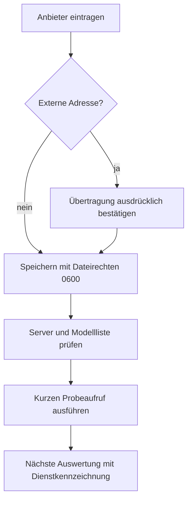
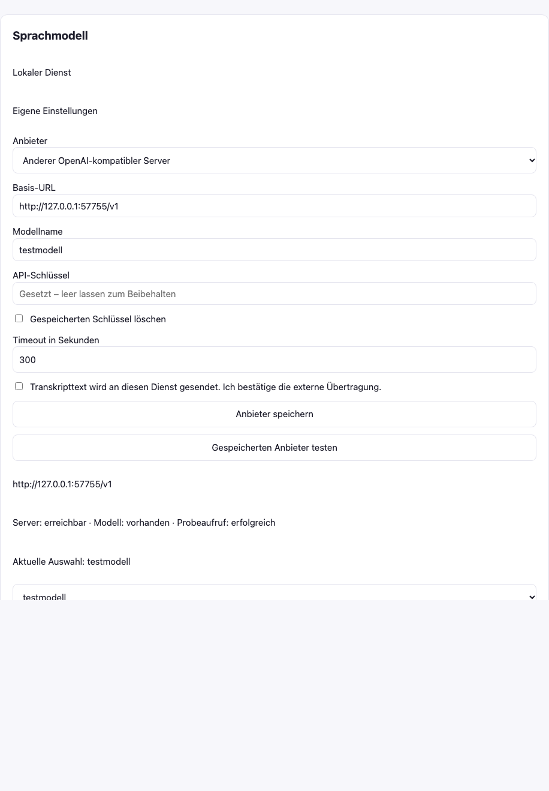
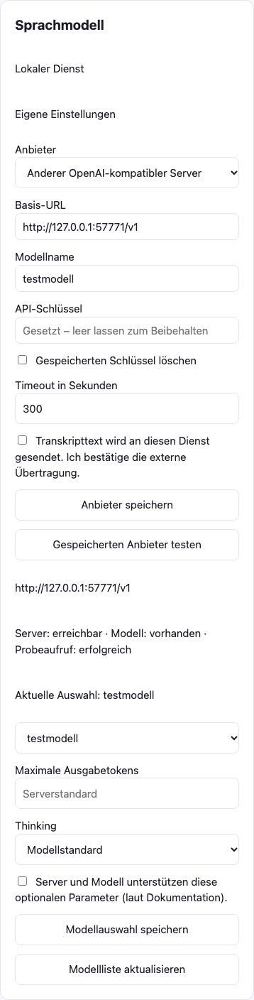

# #43 – eigenen Sprachmodell-Anbieter einrichten

Die bisherige reine Modellwahl erhält eine Anbieter-Maske. URL, Modell, Timeout
und eigener Schlüssel bleiben nach Neustart erhalten. Der Schlüssel wird nur als
„gesetzt“ angezeigt; Umgebungsvariablen behalten feldweise Vorrang.



## Reproduzieren

Entwicklungsabhängigkeiten installieren, Chromium für Playwright bereitstellen.
Dann ohne Modelle, Aufnahmen oder Cloud-Konto:

```sh
python -m pytest tests/test_provider.py tests/test_local_model.py -q
KOPROTOKOLL_UI_ARTIFACTS=/tmp/anbieter-demo python -m pytest tests/test_provider_ui.py -q
python -m pytest -q
```

Der lokale Fake-HTTP-Server liefert ausschließlich das erfundene Modell
`testmodell` und einen erfundenen Dialog. Tests prüfen Authorization mit zufällig
erzeugtem Schlüssel, 401/404, Timeout, Löschung, Validierungsfehler, Env-Vorrang,
externe Bestätigung und Ergebniskennzeichnung sowie blockierte Redirects.
Die Browser-Demo speichert den lokalen Anbieter und führt den Probeaufruf aus.




Die Bilder zeigen die echte Oberfläche nach erfolgreichem Probeaufruf bei 1280
und 390 Pixeln. Kein horizontaler Überlauf, keine JavaScript-Fehler. Die zufällige
Loopback-Portnummer gehört ausschließlich zum Fake-Server. Die Bilder zeigen
keinen echten Cloud-Dienst und keine reale Aufnahme. Backend-Gegenfälle laufen
außerhalb der Bilder. Echte Anbieter wurden nicht angesprochen.

Qualitätsprüfung nach den verlinkten anti-slop-Originalquellen: bestehende
Produktfarben und Bedienelemente übernommen, beschriftete Felder, konkrete
Übertragungsbestätigung; mobile Eingaben auf verfügbare Breite begrenzt.

Prüfergebnis vor dem Review: `python -m pytest -q` → **306 passed in 90.15s**,
keine übersprungenen Tests. Separater Backendlauf: 9 passed; Browserdemo: 2 passed.
Ein früherer Gesamtlauf fand ein Rennen im Browser-Test zwischen Speichern und
Neuladen; die Demo wartet jetzt ausdrücklich auf die neue Konfigurationsantwort.
