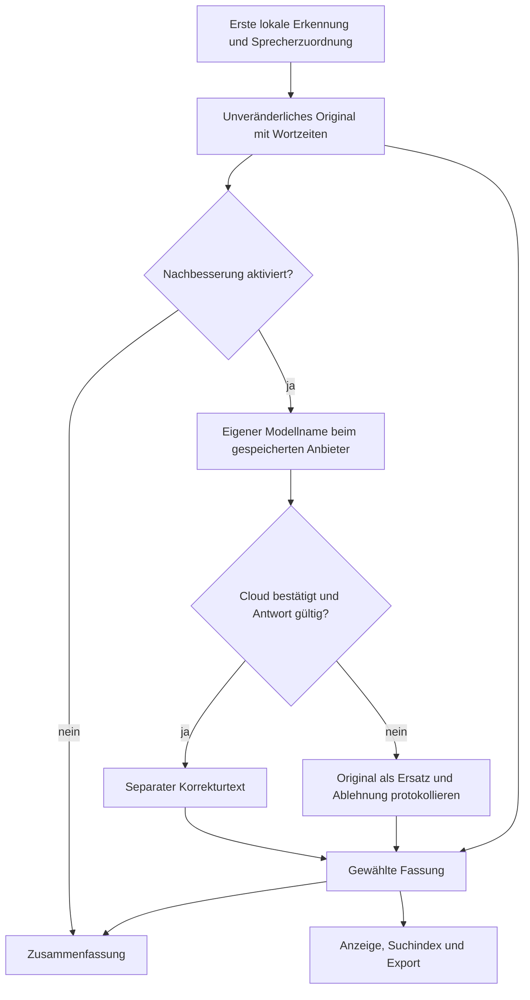

# #44: optionale Transkript-Nachbesserung

Umgesetzt durch GPT-6.1-sol, GitHub-Konto enving, am 2026-11-07 auf Basis
757f3f5 (#37 und #43 integriert). Die geprüfte Version ist der jeweilige PR-Kopf;
eine unabhängige Abnahme steht aus.

## Show-me



In den Einstellungen aktivieren, Korrekturmodell und Wortliste speichern. Die nächste
Verarbeitung ergänzt Korrekturtexte. Bei Neuverarbeitung bleibt die erste Erkennung
bestehen. Im Transkript die Fassung wählen; Änderungen erscheinen pro Äußerung als
Durchstreichung und Markierung. Anbieter und Fehlerstatus bleiben am Ergebnis sichtbar.
Die Illustration erklärt die Implementierung und ersetzt keinen Test.

## Reproduzierbare Prüfung

```sh
python -m pytest tests/test_correction.py -q
python -m pytest -q
PYTHONPATH=. python scripts/demo_correction.py /tmp/korrektur-demo
PYTHONPATH=. python scripts/compare_correction.py /tmp/korrektur-vergleich.json
```

Die UI-Demo erzeugt eine temporäre App und ein erfundenes Meeting, setzt den korrigierten
Text ausdrücklich als Demoantwort ein und beendet den Server danach. Sie ruft kein Modell
auf. Playwright prüft bei 1280×900 und 390×900 Speichern, Fassungswechsel, Markierungen,
fehlenden horizontalen Seitenüberlauf und Seitenfehler. Ergebnis: bestanden, keine
Seitenfehler. Die Demo misst weder ASR noch LLM-Qualität.

- [Einstellungen Desktop](issue-44-ui/einstellungen-1280.png)
- [Einstellungen Mobil](issue-44-ui/einstellungen-390.png)
- [Transkript Desktop](issue-44-ui/transkript-1280.png)
- [Transkript Mobil](issue-44-ui/transkript-390.png)

Fake-Server-Tests decken Übernahme, zusätzliche/fehlende Antwortstruktur, leere Antwort,
Abweichung, HTTP-Ausfall, Timeout, Wortlistenkontext, Cloud-Sperre/Freigabe samt
Fehlerkennzeichnung, Auswahl/Suche/Export, Persistenz, unveränderte Sprecher/Zeitstempel/
Wortzeiten und Originalerhalt bei Neuverarbeitung ab. Der Pipeline-Test prüft zudem die
Korrektur vor der Zusammenfassung und dass Abschalten keine weiteren Modellaufrufe erzeugt.
Unit-Tests sprechen keine realen Modelle an. Tatsächlich ausgeführt: vollständiges
`python -m pytest -q`: **332 passed in 116.79s**, keine Skips.
`node --check koprotokoll/static/app.js` und `git diff --check`: erfolgreich.
Gitleaks über neue Commits und lokale Privatbegriffprüfung: siehe PR-Prüfbericht.

## Echter lokaler Modellvergleich

Der vorhandene erfundene Gartenfest-Dialog aus `scripts/generate_audio_sample.py`
(14 Äußerungen, 312 Referenzwörter) wird als Text verwendet. Kontrolliert eingebaute Fehler:
Nachbarschafts fest, Getrenke, Donerstag. Kein erneuter ASR-Lauf und keine echte Aufnahme.
Beide bereits installierten Modelle: Q4_K_M, je 4 Milliarden Parameter, Ollama auf Loopback.
Pro Äußerung ein JSON-Aufruf, temperature=0.2, max_tokens=700, reasoning_effort=none,
Timeout 60 Sekunden. Laufzeiten umfassen alle 14 Aufrufe inklusive Laden/Prüfung.

| Modell | Sekunden | WER vorher | WER nachher | verworfene Antworten | neu erfundene Wörter |
|---|---:|---:|---:|---:|---:|
| qwen3:4b | 44,97 | 2,24 % | 0 % | 0/14 | 0 |
| qwen3-vl:4b | 46,82 | 2,24 % | 2,24 % | 14/14 | 0 |

[Maschinenlesbare Ein-/Ausgabe und Parameter](issue-44-vergleich.json).
WER stammt aus `koprotokoll.evaluation.word_error_rate` (normalisiert Schreibweise und
Satzzeichen). „Neu erfunden“ zählt Wörter der Ausgabe über die maximalen Häufigkeiten in
Referenz und Eingabe hinaus. Es ist eine mechanische Näherung: falsche Bedeutungen oder
umgestellte vorhandene Wörter erkennt sie nicht. `unexpected_count` zählt zusätzlich
Abweichungen von der Referenz, einschließlich unverändert gebliebener Eingabefehler.
Eine gesonderte Probe beim VL-Modell lieferte einen leeren Antworttext.
Beim VL-Modell sind alle Texte Originalersatz; null neue Wörter ist dort kein Qualitätsbeleg.

Ein erster Lauf mit Wortliste im Eingabeobjekt verwarf bei beiden Modellen alle Antworten
(63,72/56,67 Sekunden, WER unverändert). Eine gesonderte Probe zeigte mitkopierte
Wortlistenfelder. Daraufhin wurde die Wortliste vom geforderten Antwortobjekt getrennt;
die Tabelle zeigt den vollständigen Wiederholungslauf der endgültigen Promptform.
Ein drittes Modell fehlt lokal; kein Download, Login oder kostenpflichtiger Dienst benutzt.

Einschätzung GPT-6.1-sol, 2026-11-07: Für diesen kontrollierten Textfall ist qwen3:4b die
brauchbarere der beiden geprüften Optionen. Die Messung begründet keine allgemeine
Empfehlung für reale Meetings. Nur drei bekannte Fehlerformen mit Wortlistenhilfe,
ein Durchlauf, kein unabhängiger Holdout, keine Messung von Namen/Zahlen/Prompt-Injection.
Zeichenähnlichkeit und JSON-Prüfung können plausible falsche Aussagen nicht ausschließen.
Echte Cloud-Dienste, echte Aufnahmen und andere Server wurden nicht geprüft.

## Qualitätsprüfung

Die zuständigen Originalquellen von show-me und anti-slop wurden gelesen. Fokus auf den
beauftragten Ergänzungen, bestehende Gestaltung beibehalten. Korrigiert: zugängliche
Beschriftungen, Fehlerausgabe beim Fassungswechsel, deutsche Statusanzeige, mobiles
Textarea-Layout. PASS: neue Bedienelemente haben geprüfte Aktionen. PASS: neue Texte
beschreiben Grenzen ohne Qualitätsversprechen. PASS: neue Kommentare begründen nur
Parameterbindung und datensparsame Fehlerlogs. PASS: Desktop-/Mobilabläufe und Syntaxprüfung.
Die Bilder und Ausgaben enthalten ausschließlich erfundene Daten.
