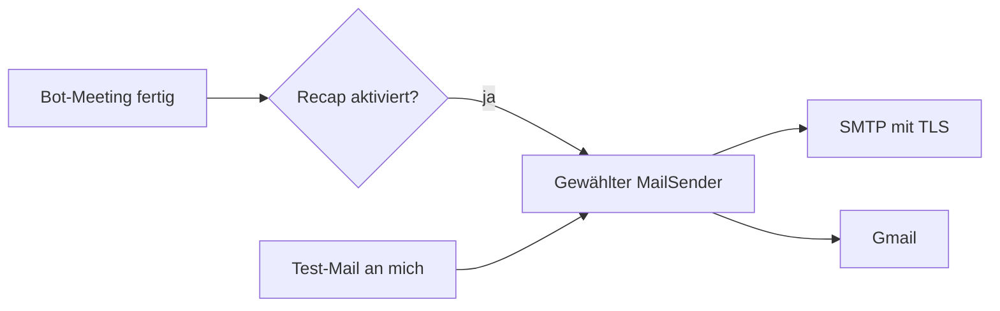

# SMTP-Recaps für Issue #7

Der ausgewählte Mailweg erhält die bestehende Text-/HTML-Zusammenfassung.
Gmail bleibt auswählbar; SMTP braucht kein Google-Konto. Es erfolgt kein
paralleler Versand über beide Wege.

Prüfung am 04.11.2026, macOS, Python 3.12, Projekt-venv:

- `tests/test_mail.py`: echter lokaler SMTP-Testserver nimmt Nachrichten entgegen;
  Betreff mit Umlauten, Text-/HTML-Teile, Empfänger, automatischer Bot-Recap und
  gespeicherte Einstellungen werden geprüft. Keine externen Mails versendet.
- SSL und STARTTLS werden separat mit nachgebildeter Verbindung geprüft:
  Zertifikatsprüfung aktiv, TLS vor Anmeldung, Passwort in Fehlermeldungen
  nicht enthalten. Der lokale SMTP-Testserver selbst hat kein TLS.
- `tests/test_mail_ui.py`: echte Oberfläche und lokale FastAPI-Test-API bei
  1280 und 390 Pixeln, jeweils hell und dunkel. Versandweg wählen, Pflichtfelder,
  Speichern, Passwortfeld leeren, Test-Mail, Neuladen und Passwort löschen.
  Der Versand im Browsertest ist nachgebildet. Keine externen Anmeldungen.
- Vorhandene Gmail- und Navigationstests bleiben erhalten.

Gezielt wiederholen: `.venv/bin/python -m pytest tests/test_mail.py tests/test_mail_ui.py -q`.
Der vollständige Testlauf und die geprüften Commit-IDs werden bei der unabhängigen
Abschlussprüfung der zusammenhängenden Änderungen angegeben.

Qualitätsprüfung nach den in CONTRIBUTING verlinkten anti-slop-Regeln:
Hard Gate: native, benannte Bedienelemente und Pflichtfelder; keine Passwortausgabe.
Purpose: Felder gehören zum gewählten SMTP-Weg, lokale Versandprobe als eigener Knopf.
Gestaltung: vorhandene Farben, Schrift und Integrationskarten beibehalten.
Funktion: vier Browserkombinationen prüfen Speichern, Wiederherstellung und
Fehlervermeidung; keine neuen Effekte oder Bildassets.

Nicht geprüft: Anmeldung und Zustellung bei echten Postfächern, Zertifikatsketten
konkreter SMTP-Anbieter und Zugriff durch Mobilgeräte außerhalb des Testbrowsers.

Bei der visuellen Abschlussprüfung wurde ein innerer horizontaler Überlauf
gefunden, den die bisherige Prüfung der Dokumentbreite verdeckte. Grid-Kinder
können jetzt schrumpfen, Formularzeilen bei Bedarf umbrechen. Der Browsertest
prüft zusätzlich jede Feld-/Knopfgrenze und die tatsächliche Breite des Hauptbereichs.
Die SMTP-Karte wurde bei 390 Pixeln dunkel und 1280 Pixeln hell visuell kontrolliert;
alle vier bestehenden Browservarianten bestehen die verschärften Prüfungen.
