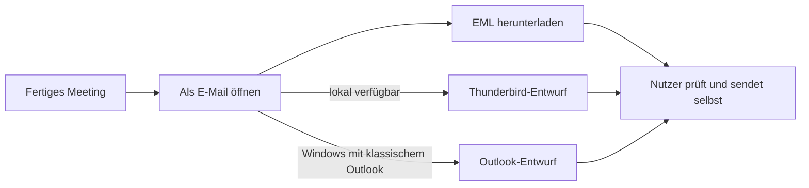

# Mailentwürfe für Issue #8

Ausgangspunkt: SMTP-Stand `6a296c5`. Umsetzung und Tests entstanden am
04.11.2026 auf macOS mit Python 3.12. Die native Outlook-Anbindung ist optional
und importiert COM erst bei ausdrücklicher Nutzung unter Windows.

`tests/test_drafts.py` prüft MIME-Kopfzeilen, Umlaute, Text-/HTML-Teil,
Empfänger und den Hinweis auf einen ungesendeten Entwurf. Native Aufrufe
werden nachgebildet: Thunderbird erhält genau ein Compose-Argument ohne Shell;
Sonderzeichen im Titel erzeugen keine zusätzlichen Compose-Felder. Outlook
bekommt `CreateItem(0)` und `Display()`, keinen Sendeaufruf.

Der Browsertest lädt die echte Oberfläche mit lokaler FastAPI-Test-API bei
1280 und 390 Pixeln. Er öffnet das Entwurfsmenü, ruft den nachgebildeten nativen
Weg auf und lädt eine echte, erneut geparste EML-Datei herunter. Kein Seitenüberlauf
und keine JavaScript-Ausnahme in diesen Abläufen.

Gezielt wiederholen: `.venv/bin/python -m pytest tests/test_drafts.py -q`.
Die vollständige Abschlussprüfung nennt den endgültigen Commit und Gesamttestlauf.

Referenz für Thunderbird ist dessen
[Compose-Parser](https://github.com/mozilla/releases-comm-central/blob/master/mail/components/compose/content/MsgComposeCommands.js),
Funktionen `GetArgs` und Behandlung von `args.message`.
Die URI-Kodierung wird erst nach dem Zerlegen der doppelt zitierten Werte dekodiert.
Die HTML-Datei bleibt zum verzögerten Lesen im ignorierten Datenordner.

Qualitätsprüfung: vorhandene Oberfläche und Farbvariablen beibehalten,
benanntes natives Auswahlfeld, nur verfügbare Ziele, deaktiviert bei unfertigem
Meeting, echtes Downloadziel und verständliche Fehlermeldung mit Ausweichweg.

Nicht geprüft: ein echtes Thunderbird-Fenster, Windows-Outlook und das Verhalten
verschiedener Mailprogramme beim Öffnen von EML. Native Programme werden aus
externen API-Anfragen auch mit gültigem Schlüssel nicht gestartet.
