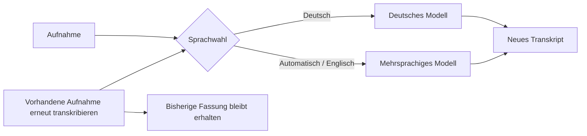

# Sprachwahl und automatischer Aufnahmestopp

Geprüft am 14.11.2026 mit GPT-6.1-sol auf macOS/Apple Silicon.
Lokale Umsetzung auf `main`; kein Push, keine unabhängige PR-Freigabe.

Die Weboberfläche und die Mac-Menüleisten-App bieten Deutsch, Automatisch und
Englisch an. Deutsch ist in den Oberflächen voreingestellt. Die Hardwareaufnahme
übergibt die Auswahl jetzt bis zur Transkriptionspipeline. Bestehende Aufnahmen
können im Tab Transkript eine neue Erkennung mit anderer Sprachwahl erhalten.



Die Modellzuordnung folgt der [bestehenden Konfiguration](../einrichtung.md#sprachwahl-und-cpu-modelle);
ein ausdrücklich festgelegtes v3-Modell hat auch bei Deutsch Vorrang.

Während der Aufnahme prüft lokales Silero-VAD die Sprachaktivität. Nach fünf
Minuten ohne erkannte Sprache wird gestoppt, gespeichert und ausgewertet.
Bei Hardwareaufnahmen übernimmt der Server die Überwachung, bei Browseraufnahmen
der laufende Tab. Neue Sprache setzt den Zähler zurück. Bei Detektorfehlern zählt
die Zeit neu; ein alter Überwachungslauf kann keine neue Aufnahme stoppen.

Prüfung:

- Vorher: `pytest -q` – 332 bestanden. Neue Regressionstests zeigten die fehlende
  Sprachweitergabe (`auto` statt `de`/`en`) und den fehlenden Neuaufnahme-Endpunkt.
- Nachher: `.venv/bin/pytest -q` – **345 bestanden in 121,52 s**, keine Skips.
- `tests/test_multilingual.py`: Auswahl bei Hardwareaufnahmen, echte neue
  Erkennung, unverändertes altes Transkript, voneinander unabhängige Audiokopien,
  ungültige Sprache, fehlendes Audio und noch laufende Verarbeitung.
- `tests/test_activity.py`: 300-Sekunden-Grenze mit simulierter Uhr, Rücksetzen
  durch Sprache, Detektorfehler, genau eine Speicherung, Schutz vor alten
  Überwachungsläufen, PCM-Ausschnitt aus noch nicht abgeschlossenem WAV-Header.
- `tests/test_language_ui.py`: echte Browserformulare bei 1280 und 390 Pixeln,
  Upload, Sprachwahl, Fehlermeldung und Wiederholung, Hardware-/Browseraufnahme,
  automatisches Schließen und Öffnen des gespeicherten Meetings, keine
  JavaScript-Seitenfehler und kein horizontaler Seitenüberlauf. Hardware und
  Transkription sind simuliert; Browsermikrofon nutzt Chromiums Testquelle.
  Für den Browser-Stopp wird die Antwortgrenze im Test auf eine Sekunde verkürzt;
  die echte 300-Sekunden-Grenze prüft separat der Uhrentest.
- Native Swift-Einstellungsprüfung: 17 Fälle einschließlich gespeicherter
  Sprachwahl und Rückfall auf Deutsch. Gesamte Mac-App erfolgreich kompiliert.
- Echtes lokales Silero-VAD: Nullsignal als Nicht-Sprache, gesprochener Ausschnitt
  als Sprache erkannt. Der WAV-Leser konnte beide Sekunden einer nativen
  Hardware-WAV lesen. Keine Downloads während dieser Prüfungen.
- Deutsch-Modell ausdrücklich installiert und ein bestehendes lokales Audio
  über den neuen Endpunkt erneut verarbeitet. Alte Fassung unverändert geprüft.
  Diese Stichprobe verbessert Sprachverwechslungen, enthält weiterhin Hörfehler;
  sie belegt keine allgemeine Erkennungsquote. Private Audios und Texte sind
  nicht Teil dieses Nachweises.
- `node --check koprotokoll/static/app.js` und `git diff --check` erfolgreich.

Browserprüfung mit Bildern wiederholen:

```bash
KOPROTOKOLL_UI_ARTIFACTS=/tmp/koprotokoll-sprachwahl \
  .venv/bin/pytest -q tests/test_language_ui.py
```

Grenzen: keine fünfminütige reale Mikrofon-/Systemtonaufnahme durchgeführt,
kein manueller Accessibility-Durchlauf der nativen Einstellungen, kein
Spracherkennungs-Benchmark. Musik und sehr leise Sprache können VAD beeinflussen.
Ein suspendierter Browser kann die Browseraufnahme nicht zuverlässig überwachen;
die serverseitige Hardwareüberwachung ist davon unabhängig.

## Nachtrag: Eine Person wurde mehrfach zugeordnet

Folgeänderung vom 14.11.2026: Die Übersicht kann alle Sprecherlabels als eine Person
zusammenführen und die gesicherte frühere Aufteilung wiederherstellen. Die bestehende
Erkennung wird dabei nicht erneut ausgeführt. Explizit `num_speakers=1` überspringt
bei neuen Aufnahmen die automatische Aufteilung. Die Mac-App bietet dafür eine
gespeicherte Auswahl von Automatisch oder 1–20 Personen.

`tests/test_single_speaker.py` prüft den festen Ein-Sprecher-Weg, Zusammenführen,
Erhalt von Text, Wortzeiten, Nachbesserungen, Segment-IDs, Markierungen und Suche,
Schutz der Sicherung bei wiederholtem Aufruf und Wiederherstellung nach erneuter
Verarbeitung. Noch laufende Erkennung wird abgewiesen. Zwei Browserfälle bei 1280
und 390 Pixeln führen die Korrektur und Wiederherstellung über die tatsächlichen
Schaltflächen aus, ohne Seitenfehler oder horizontalen Überlauf.

Gezielte Prüfung: 27 Tests bestanden (`test_single_speaker.py`, `test_desktop.py`,
`test_speaker_names.py`). Native Einstellungen: nun 20 Fälle einschließlich
gespeicherter Sprecherzahl. Die komplette Swift-App wurde erfolgreich gebaut.
Keine allgemeine Verbesserung der automatischen Sprecherzählung behauptet; deren
Schwelle wurde nicht anhand einer einzelnen Aufnahme verändert. Bei vorgegebener
oder manuell korrigierter Sprecherzahl kennzeichnet die Oberfläche diese Herkunft.

Gesamtprüfung nach dieser Folgeänderung: `.venv/bin/pytest -q` – **351 bestanden
in 124,15 s**, keine Skips. Lokaler Server und Mac-App anschließend aktualisiert.
Bei einer vorhandenen Aufnahme wurden die Labels zusammengeführt und Text,
Wortzeiten, Markierungen sowie Zusammenfassung unverändert gegengeprüft. Die
frühere Aufteilung ist gesichert. Keine neue ASR- oder automatische
Sprechererkennung für diese Korrektur ausgeführt.

## Nachtrag: Lesetext ohne wiederholte Zeitmarken

Standardansicht ist jetzt **Lesetext**. Direkt aufeinanderfolgende Segmente derselben
Person werden in lesbare Absätze verbunden. Bei einer Person entfallen die
wiederholten Sprecherlabels vollständig. Bei mehreren Personen erscheinen Namen
beim tatsächlichen Sprecherwechsel. **Mit Zeitmarken** stellt die bisherige
segmentweise Ansicht samt Audiolinks und Soundbite-Markierung wieder her.

`tests/test_transcript_reading_ui.py`: drei Browserfälle bei 1280/390 Pixeln prüfen
Voreinstellung, vollständigen zusammenhängenden Text, fehlende Zeitmarken,
Suche über Segmentgrenzen, leeres Suchergebnis, Wiedergabehervorhebung,
echte Sprecherwechsel, Umschalten, gespeicherte Ansicht, Soundbite-Anlage sowie
unveränderte gespeicherte Segmente. Alle drei Fälle bestanden. Die Bilder nutzen
erfundene Texte; es wurde kein privates Transkript als Bild gespeichert.

Gesamtprüfung: `.venv/bin/pytest -q` – **354 bestanden in 124,99 s**, keine Skips.
Auch am laufenden lokalen Server geprüft: Lesetext ohne Zeitmarken, alle bestehenden
Textabschnitte vollständig und gespeicherte Meeting-Daten unverändert. Nur statische
Oberflächendateien geändert; kein Serverneustart erforderlich.
