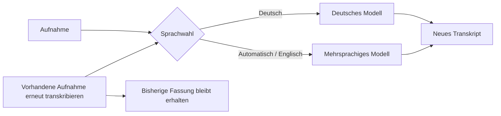

# Sprachwahl und automatischer Aufnahmestopp

Geprüft am 14.11.2026 mit GPT-6.1-sol auf macOS/Apple Silicon.
Lokale Umsetzung auf `main`; kein Push, keine unabhängige PR-Freigabe.

Die Weboberfläche und die Mac-Menüleisten-App bieten Deutsch, Automatisch und
Englisch an. Deutsch ist in den Oberflächen voreingestellt. Die Hardwareaufnahme
übergibt die Auswahl jetzt bis zur Transkriptionspipeline. Bestehende Aufnahmen
können im Tab Transkript eine neue Erkennung mit anderer Sprachwahl erhalten.



Die Modellzuordnung folgt der [bestehenden Konfiguration](../einrichtung.md#sprachwahl-und-cpu-modelle);
ein ausdrücklich festgelegtes v3-Modell hat auch bei Deutsch Vorrang.

Während der Aufnahme prüft lokales Silero-VAD die Sprachaktivität. Nach fünf
Minuten ohne erkannte Sprache wird gestoppt, gespeichert und ausgewertet.
Bei Hardwareaufnahmen übernimmt der Server die Überwachung, bei Browseraufnahmen
der laufende Tab. Neue Sprache setzt den Zähler zurück. Bei Detektorfehlern zählt
die Zeit neu; ein alter Überwachungslauf kann keine neue Aufnahme stoppen.

Prüfung:

- Vorher: `pytest -q` – 332 bestanden. Neue Regressionstests zeigten die fehlende
  Sprachweitergabe (`auto` statt `de`/`en`) und den fehlenden Neuaufnahme-Endpunkt.
- Nachher: `.venv/bin/pytest -q` – **345 bestanden in 121,52 s**, keine Skips.
- `tests/test_multilingual.py`: Auswahl bei Hardwareaufnahmen, echte neue
  Erkennung, unverändertes altes Transkript, voneinander unabhängige Audiokopien,
  ungültige Sprache, fehlendes Audio und noch laufende Verarbeitung.
- `tests/test_activity.py`: 300-Sekunden-Grenze mit simulierter Uhr, Rücksetzen
  durch Sprache, Detektorfehler, genau eine Speicherung, Schutz vor alten
  Überwachungsläufen, PCM-Ausschnitt aus noch nicht abgeschlossenem WAV-Header.
- `tests/test_language_ui.py`: echte Browserformulare bei 1280 und 390 Pixeln,
  Upload, Sprachwahl, Fehlermeldung und Wiederholung, Hardware-/Browseraufnahme,
  automatisches Schließen und Öffnen des gespeicherten Meetings, keine
  JavaScript-Seitenfehler und kein horizontaler Seitenüberlauf. Hardware und
  Transkription sind simuliert; Browsermikrofon nutzt Chromiums Testquelle.
  Für den Browser-Stopp wird die Antwortgrenze im Test auf eine Sekunde verkürzt;
  die echte 300-Sekunden-Grenze prüft separat der Uhrentest.
- Native Swift-Einstellungsprüfung: 17 Fälle einschließlich gespeicherter
  Sprachwahl und Rückfall auf Deutsch. Gesamte Mac-App erfolgreich kompiliert.
- Echtes lokales Silero-VAD: Nullsignal als Nicht-Sprache, gesprochener Ausschnitt
  als Sprache erkannt. Der WAV-Leser konnte beide Sekunden einer nativen
  Hardware-WAV lesen. Keine Downloads während dieser Prüfungen.
- Deutsch-Modell ausdrücklich installiert und ein bestehendes lokales Audio
  über den neuen Endpunkt erneut verarbeitet. Alte Fassung unverändert geprüft.
  Diese Stichprobe verbessert Sprachverwechslungen, enthält weiterhin Hörfehler;
  sie belegt keine allgemeine Erkennungsquote. Private Audios und Texte sind
  nicht Teil dieses Nachweises.
- `node --check koprotokoll/static/app.js` und `git diff --check` erfolgreich.

Browserprüfung mit Bildern wiederholen:

```bash
KOPROTOKOLL_UI_ARTIFACTS=/tmp/koprotokoll-sprachwahl \
  .venv/bin/pytest -q tests/test_language_ui.py
```

Grenzen: keine fünfminütige reale Mikrofon-/Systemtonaufnahme durchgeführt,
kein manueller Accessibility-Durchlauf der nativen Einstellungen, kein
Spracherkennungs-Benchmark. Musik und sehr leise Sprache können VAD beeinflussen.
Ein suspendierter Browser kann die Browseraufnahme nicht zuverlässig überwachen;
die serverseitige Hardwareüberwachung ist davon unabhängig.
